# Software engineering & creative development

**Full-stack development · Application architecture · Interactive systems**

I'm a self-taught developer based in Brazil with an interest in building reliable software, understanding complex systems and turning ideas into usable products. My experience spans web applications, backend integrations and interactive development.

[Public repositories](https://github.com/italodevjs?tab=repositories) · [LinkedIn](https://www.linkedin.com/in/italodevjs)

## Selected projects

| Project | Engineering focus | Status |
|:--|:--|:--|
| [ITDV](https://github.com/italodevjs/itdv) | Source code, examples, technical documentation and contribution guidelines | Public repository |
| [HB Team Premium](https://github.com/italodevjs/hb-team-premium) | Full-stack application with separate client, server and shared modules | Public repository |
| Caliber | Creator platform, authentication, payments and media delivery | Historical project — offline |

## Engineering case study — Caliber

Caliber was a creator biolink platform that combined profile customization, social integrations and payment workflows. The service and its database are no longer running. This case study describes previous development experience, not an active deployment.

**Architecture used:** Next.js, TypeScript, React, PostgreSQL, Supabase, Tailwind CSS and Cloudflare.

| Challenge | Engineering approach |
|:--|:--|
| Media delivery and bandwidth costs | Designed a read-through caching approach using object storage and a CDN |
| Payment reliability | Worked with webhook verification and idempotent entitlement grants |
| Data access | Used database migrations and row-level security policies |
| External integrations | Worked with OAuth and third-party APIs |
| Application security | Explored server-side request forgery prevention and input validation |

The project reinforced the importance of monitoring resource consumption, designing for failure and evaluating infrastructure trade-offs before deployment.

## Technical experience

| Area | Technologies and concepts |
|:--|:--|
| Frontend | TypeScript, JavaScript, React, Next.js, Tailwind CSS |
| Backend | Node.js, API design, authentication, Zod |
| Data | PostgreSQL, SQL, Supabase, migrations, access policies |
| Infrastructure | Vercel, Cloudflare Workers, R2, Docker |
| Quality | Git, GitHub Actions, Vitest, ESLint |
| Interactive development | Roblox Studio, Luau, Blender |

These are technologies I have worked with; this list does not imply that I currently operate paid infrastructure or live databases.

## Academic interests

I intend to pursue formal computing education in Canada, with particular interest in computer science and software engineering.

My learning priorities are algorithms and data structures, discrete mathematics, operating systems, networking, database design and secure software development. I want to connect practical project experience with rigorous computer science fundamentals.

I use AI-assisted development tools as part of my workflow and aim to understand, verify and maintain the software I build.

## Engineering principles

- Prefer clear, maintainable architecture over unnecessary complexity.
- Treat authentication, authorization and data validation as core design concerns.
- Use documentation and tests to make technical decisions reproducible.
- Learn from failures and communicate limitations accurately.

## Contact

[LinkedIn](https://www.linkedin.com/in/italodevjs) · [Email](mailto:caetanoitalo60@gmail.com)
